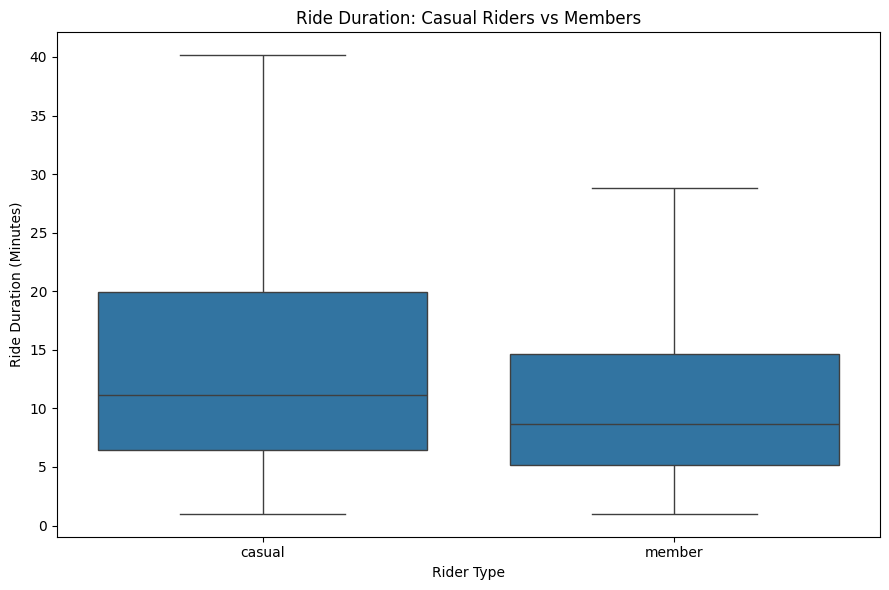
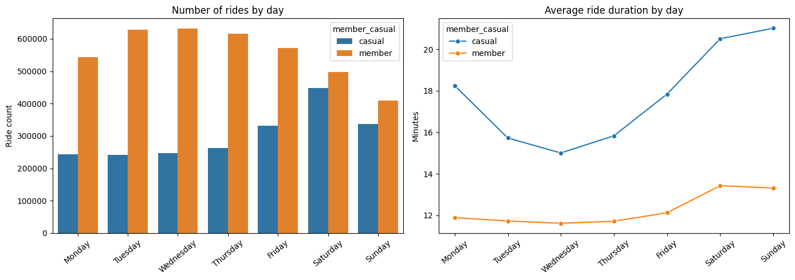
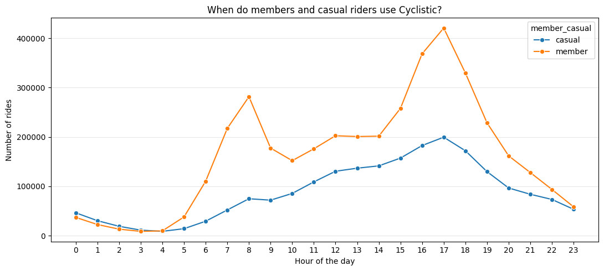
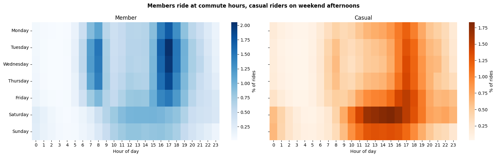
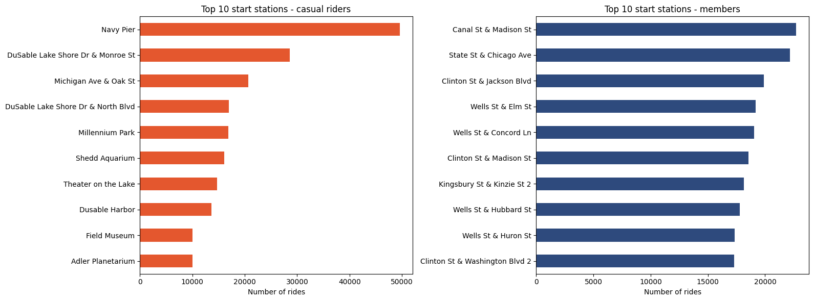
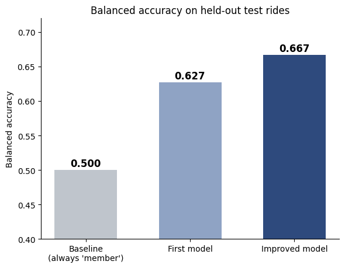
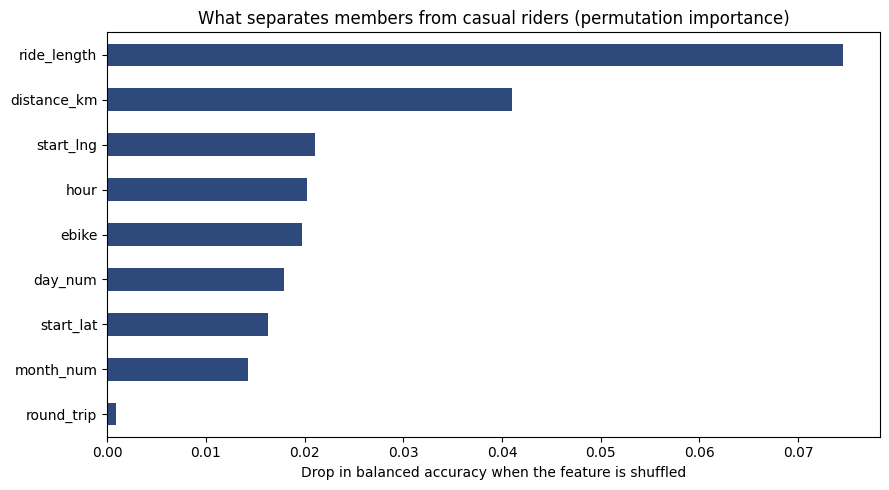
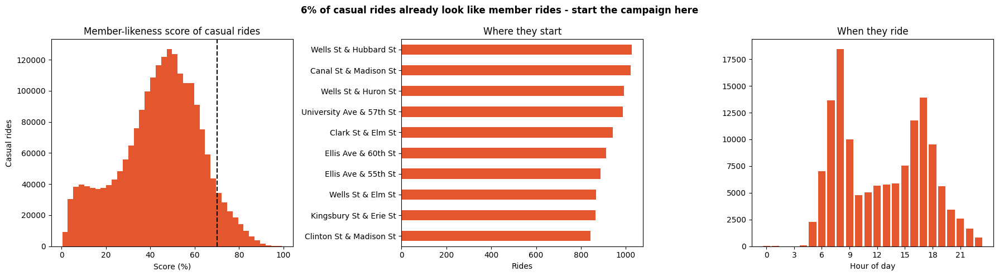

# Cyclistic Bike-Share: How Members and Casual Riders Ride Differently

Google Data Analytics Certificate, Capstone Case Study 1

I analysed twelve months of Chicago bike-share trips (**October 2025 to September 2026, 6 million rides**) to find out how annual members and casual riders use the service differently. I then trained a Random Forest model to find the casual riders who already ride like members, since they are the easiest people to convert.

**Tools:** Python (pandas, NumPy, Matplotlib, Seaborn, scikit-learn) in Google Colab

| | |
|---|---|
| 📄 Final report | [reports/cyclistic_final_report](reports/cyclistic_final_report) |
| 📊 Presentation | [reports/cyclistic_presentation](reports/cyclistic_presentation.pptx) |
| 💻 Notebook | [notebooks/cyclistic_analysis.ipynb](notebooks/cyclistic_analysis.ipynb) |
| 📋 Scope of work | [reports/cyclistic_scope_of_work](reports/cyclistic_scope_of_work) |
| 📝 Analysis log | [reports/cyclistic_data_analysis_journal](reports/cyclistic_data_analysis_journal) |

---

## The business question

Cyclistic, a fictional bike-share company in Chicago, has found that annual members are more profitable than casual riders (people who buy single rides or day passes). The marketing director wants to grow by converting casual riders into members, and asked:

> **How do annual members and casual riders use Cyclistic bikes differently?**

## Short answer

**Members use the bikes to get around the city. Casual riders use them for fun.**

| | Members | Casual riders |
|---|---|---|
| Share of all rides | 64.9% | 35.1% |
| Median ride | 8.7 min | 11.1 min |
| Average ride | 12.2 min | 18.2 min |
| Busiest day | Wednesday | Saturday |
| Rides at the weekend | 23.3% | 37.2% |
| Rides in summer (Jun–Aug) | 37.4% | 46.4% |
| Rides on e-bikes | 68.3% | 74.2% |
| Top start station | Canal St & Madison St | Navy Pier |

About **6% of casual rides already look like member rides**: they happen at 8 AM and 5 PM and start in the business district. These riders are the natural first target for a membership campaign.

---

## Data

- **Source:** [Divvy trip history data](https://divvy-tripdata.s3.amazonaws.com/index.html), used here as Cyclistic's data
- **License:** [Divvy Data License Agreement](https://www.divvybikes.com/data-license-agreement)
- **Period:** 12 monthly CSV files, October 2025 to September 2026
- **Size:** 6,171,785 raw rides, 13 columns, no personal information

The raw CSV files are **not included** in this repository, because most of them are larger than GitHub's 100 MB file limit. To run the notebook, download the 12 files from **202510-divvy-tripdata.zip** to **202609-divvy-tripdata.zip** from the source above, unzip them and put the CSVs in a folder called `12_months_datasets/`.

## Cleaning

| Step | Rows removed |
|---|---|
| Missing end coordinates | 5,451 |
| Ride length zero or negative | 29 |
| Rides under 1 minute (false starts, re-docking) | 159,192 |
| Rides over 24 hours (lost bikes, system errors) | 181 |
| Rides that started before 1 Oct 2025 (saved in the October file) | 58 |
| **Rides left for analysis** | **6,006,874** |

Rides with no station name were **kept**. They are mostly e-bikes locked outside a docking station.

New columns: `ride_length`, `day_of_week`, `day_type`, `hour`, `month`, `season`, `round_trip`, `distance_km` (haversine).

## Key findings

**1. Casual riders ride for longer.** The median casual ride is 11.1 minutes against 8.7 for members, and casual rides have a much longer tail.



**2. Members ride on weekdays, casual riders at the weekend.** On Saturday the two groups are almost level.



**3. Members follow the commute.** Members have clear peaks at 8 AM and 5 PM. Casual riders have no morning rush.





**4. Casual riding is a summer business.** Casual rides are about 15 times higher in July than in January. For members the difference is about 5 times.


**5. Different parts of the city.** Casual riders start at Navy Pier and the lakefront. Members start in the Loop, next to the main train stations.



## Machine learning: who to convert first

I trained a Random Forest to predict whether a ride was taken by a member or a casual rider, then used it to score every casual ride on how "member-like" it is.

| Model | Balanced accuracy | Notes |
|---|---|---|
| Baseline (always predicts "member") | 0.50 | |
| First model: time, ride length, bike type | 0.627 | 200,000-ride sample |
| Improved model: adds start location, distance, round trip | **0.667** | ROC-AUC **0.736**, 300,000-ride sample |

I used **balanced accuracy** because members make up almost two-thirds of the rides, so plain accuracy would reward a model that always guesses "member".



**Ride length is the strongest signal**, followed by distance and start longitude (permutation importance). Whether a ride is a round trip adds almost nothing.



Casual rides scoring **0.7 or higher** (about 6%) peak at 8 AM and 5 PM and start at business-district stations such as Wells St & Hubbard St and Canal St & Madison St. University Ave & 57th St, near the University of Chicago, also shows up in the top five.



## Recommendations

1. **Win over the casual commuters.** Target the stations where member-like casual rides start, at 7–9 AM and 4–6 PM on weekdays, and show how much a regular rider would save with a membership. Try a student offer near the University of Chicago.
2. **Give leisure riders a plan that fits.** Offer a weekend or summer membership with extra ride time and e-bike minutes, promoted at Navy Pier and the lakefront on weekend afternoons.
3. **Time the campaign to the season.** Start in April and May, push hardest from June to August, and finish with a discounted annual offer at the end of summer.

## Limitations

- **No rider IDs.** Every result describes rides, not people.
- **Moderate model.** The model is only moderately accurate (balanced accuracy 0.67), so the member-like group is a starting point for targeting, not a list of confirmed future members. A small A/B test should come before a full rollout.
- **One year of data.** A second year would show whether the patterns hold.
- **Trip data only.** *Why* casual riders don't buy memberships needs survey data.

## Repository structure

```
cyclistic_share_analysis/
├── README.md
├── notebooks/
│   └── Cyclistic_analysis.ipynb   # cleaning, analysis, charts and model
├── reports/
│   ├── Scope_of_Work.pdf
│   ├── Analysis_Log.pdf
│   ├── Final_Report.pdf
│   └── Presentation.pdf
├── charts/                        # all figures used in the report
├── 12_months_datasets/            # raw CSVs, not uploaded (see Data)
├── requirements.txt
├── .gitignore
└── LICENSE
```

## How to run it

1. Download the 12 monthly files (see [Data](#data)) into `12_months_datasets/`.
2. Open `notebooks/Cyclistic_analysis.ipynb` in Google Colab, or locally after `pip install -r requirements.txt`.
3. Set `directory_path` to the folder with the CSV files and `output_path` to where charts and tables should be saved. If you run it locally, remove the `google.colab` import and the `drive.mount(...)` line.
4. Run all cells. Six million rows take a few GB of memory, which the standard Colab runtime handles.

## About

Venkata Praveen Jasthi · [LinkedIn](http://www.linkedin.com/in/%20venkata-praveen-jasthi-825070357) · [Email](mailto:jasthipraveen*@gmail.com)

The case study and the company "Cyclistic" come from the Google Data Analytics Professional Certificate. The data is made available by Divvy under the Divvy Data License Agreement. This is an independent analysis for learning purposes and is not affiliated with Divvy, Lyft or the City of Chicago.
